# Probadores Rincón Sur

Aplicación móvil para la sección Vestuario de Tienda Rincón Sur (sucursal RS-014 Zona Norte).
Permite llevar la fila de espera y el estado de los probadores, informar al cliente el tiempo
estimado de espera y entregar a la jefatura un resumen diario con la venta potencial perdida.

Evaluación Sumativa 3 · DSY1105 Desarrollo de Aplicaciones Móviles · Sección 003D · Equipo EQ020

## Integrantes

- Felipe Antonio Lara Ruiz
- Sebastián Ariel Villagra Luengo

## Funcionalidades implementadas

Todas las cuentas ingresan con **RUT y contraseña**. Nada se ve sin cuenta, y cada tipo de cuenta abre en su propia vista.

**Cliente (crea su propia cuenta con RUT, nombre y contraseña)**
- Toma un turno desde su teléfono indicando las prendas y si necesita atención preferente.
- Sigue su turno en vivo: personas antes, espera estimada y aviso cuando lo llaman.
- Puede retirarse de la fila indicando el motivo.

**Vendedor(a) (abre en Fila)**
- Registra turnos en el mesón (1 a 6 prendas, atención preferente con motivo) y los retiros de la fila.
- Consulta el estado de los probadores, sin operarlos.

**Asistente de probadores (abre en Probadores)**
- Estado en tiempo real de los probadores de la sección (libre, ocupado, en ordenamiento, fuera de servicio).
- Llamado de turnos, asignación de probador sugerido y registro de no presentación.
- Uso de probador sin fila, incluso registrado con atraso de hasta 15 minutos.
- Término de uso con prendas devueltas y ordenamiento del probador.
- Alertas de uso prolongado, probador libre sin asignar, turno sin presentarse y cierre de la fila, con vibración.

**Jefatura (abre en Resumen)**
- Todo lo del asistente y del vendedor(a).
- Marcar probadores fuera de servicio con motivo y foto de evidencia (cámara o galería), y volver a habilitarlos.
- Resumen por día y franja horaria: ingresos, abandonos, espera y uso promedio, conversión y venta potencial perdida.
- Crea las cuentas de los colaboradores (solo la jefatura puede hacerlo) y restablece sus contraseñas.
- Mantenedor de probadores (agregar, cambiar el tipo, eliminar) y ajuste de parámetros de la sección.
- Configuración inicial de la sección la primera vez que se abre la app.
- Cierre de jornada.

**Todas las cuentas**
- Mi perfil: ver y editar los datos propios (nombre y, en colaboradores, turno habitual).
- Cambiar contraseña indicando la actual; recuperar la contraseña con el código de recuperación.
- Modo punto de espera (colaboradores): deja el equipo mostrando la espera a los clientes; salir pide la contraseña.

**Búsqueda y filtros**
- Probadores: filtro por estado (libres, ocupados, en ordenamiento, fuera de servicio) con la cantidad de cada uno.
- Fila: filtro por en espera, llamados o preferentes, y búsqueda por número de turno.
- Colaboradores (jefatura): búsqueda por nombre o RUT, filtro por perfil y opción para ver los inactivos.
- Las alertas de probadores libres se agrupan en una sola ("3 probadores libres sin asignar").

**Clima de la tienda (API externa)**
- El cliente (al tomar su turno) y la jefatura (en Resumen) ven la temperatura y el estado del tiempo en la tienda,
  con una sugerencia de ropa para probarse. Viene de la API pública Open-Meteo y no se guarda en Room ni en los microservicios.

**Notificaciones (segundo recurso nativo)**
- Permiso `POST_NOTIFICATIONS`, pedido en el momento en que tiene sentido: al personal al entrar al panel y al cliente al tomar su turno.
- Personal: aviso cuando aparece una alerta urgente (uso prolongado con fila o probadores libres sin asignar). Se puede desactivar en Ajustes.
- Cliente: aviso cuando llaman su turno.
- Funcionan con la app abierta o en segundo plano, mientras el sistema no la cierre.

## Tecnologías

- Kotlin, Jetpack Compose y Material 3
- Arquitectura MVVM con StateFlow
- Navigation Compose
- Room (entidades, DAOs y relaciones) para los datos del negocio, con un repositorio entre los ViewModels y la base de datos
- DataStore Preferences solo para la sesión y las preferencias del equipo
- Cámara y galería con ActivityResultLauncher y FileProvider
- Vibración del dispositivo
- Notificaciones locales con canales y permiso en tiempo de ejecución
- Retrofit + Gson para consumir los microservicios a través del API Gateway
- Retrofit (cliente aparte) para la API externa de clima Open-Meteo
- JUnit 4, kotlinx-coroutines-test y JaCoCo para las pruebas unitarias y su cobertura

## Ejecución

0. Levantar el backend (`ms-ProbadoresRinconSur`: MySQL, Eureka, los 3 servicios y el Gateway en el puerto 8080).
1. Clonar el repositorio y abrir la carpeta del proyecto en Android Studio.
2. Sincronizar Gradle y ejecutar el módulo `app` en un emulador o teléfono (Android 8.0 o superior).
3. La app parte **sin datos**. La primera vez abre el asistente de configuración inicial:
   1. Crear la cuenta de jefatura (RUT, nombre, turno y contraseña).
   2. Indicar cuántos probadores estándar y accesibles tiene la sección.
   3. Anotar el código de recuperación que se muestra una sola vez.
4. Desde Ajustes, la jefatura agrega al resto del equipo (Colaboradores) y administra los probadores.

Al abrir la app se muestra directamente el ingreso. Si ya hay una sesión abierta, la app entra directo a la vista de esa cuenta.

Fuera del horario de la tienda (10:00 a 21:00) se puede activar el modo demostración en Ajustes.

### Conexión con el servidor

Los datos viven en los microservicios; Room guarda una copia local para mostrar la pantalla al instante.
Cada acción se envía primero al servidor y solo se guarda en el teléfono si el servidor la acepta.
Cada 5 segundos la app descarga los cambios hechos desde otros equipos.

La dirección del API Gateway se cambia con el botón **Servidor** (pantalla de ingreso, asistente inicial o Ajustes):

| Dónde corre la app | Dirección |
|---|---|
| Emulador | `http://10.0.2.2:8080/` (por defecto). Si no conecta: `adb reverse tcp:8080 tcp:8080` y usar `http://127.0.0.1:8080/` |
| Teléfono por USB | `adb reverse tcp:8080 tcp:8080` y usar `http://127.0.0.1:8080/` |
| Teléfono | La URL pública de VS Code (Puertos → reenviar 8080 → visibilidad pública), por ejemplo `https://abc123-8080.brs.devtunnels.ms/` |
| Sin servidor | Dejar la dirección vacía: todo queda solo en el teléfono (Room) |

Sin conexión se siguen viendo los últimos datos descargados, pero no se pueden registrar cambios.

### Cuentas y contraseñas

- **Cliente:** crea su cuenta desde el ingreso ("Crear cuenta de cliente") con RUT, nombre y contraseña.
- **Colaborador:** su cuenta solo la crea la jefatura en Ajustes → Colaboradores. En su primer ingreso elige su contraseña.
- Un mismo RUT no puede tener cuenta de cliente y de colaborador.
- Al crear o cambiar la contraseña se muestra una sola vez un **código de recuperación** (`XXXX-XXXX`).
  Con "¿Olvidó su contraseña?" se ingresa ese código y se elige una nueva. A un colaborador sin código,
  la jefatura le puede restablecer la contraseña.
- 5 intentos fallidos bloquean el ingreso por 1 minuto. Con servidor, las contraseñas las valida usuarios-service (BCrypt);
  sin servidor, se guardan en el teléfono como hash PBKDF2 con sal.
- La pantalla recuerda los últimos accesos del equipo para ingresar con un toque.

## Capturas

Tomadas en un dispositivo físico.

| Probadores | Asignar probador | Fila de espera |
|---|---|---|
| 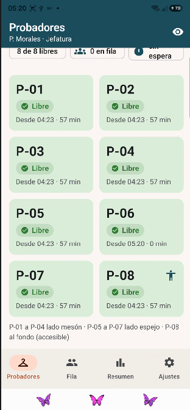 |  |  |

| Nuevo turno | Turno registrado | Consulta del cliente |
|---|---|---|
| 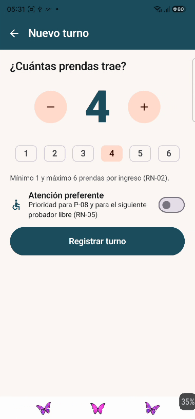 | 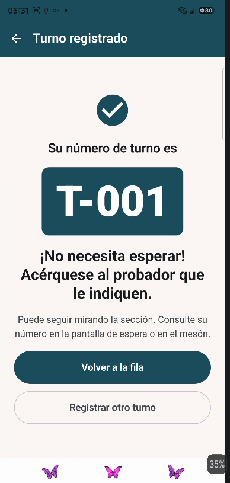 |  |

| Uso sin fila | Abandono | Nuevo colaborador |
|---|---|---|
|  |  | 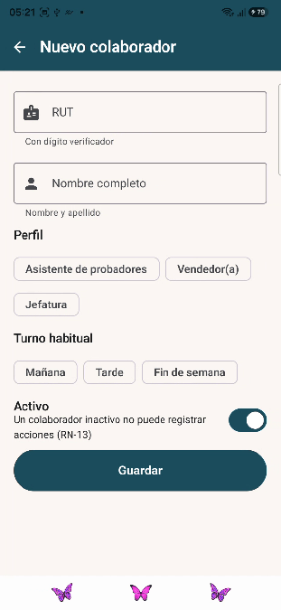 |

| Fuera de servicio | Cámara | Probador con evidencia | Resumen |
|---|---|---|---|
| 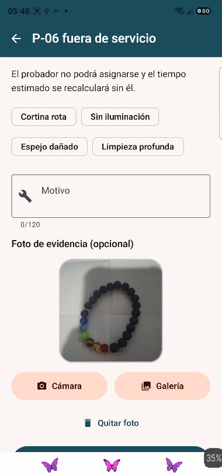 |  |  | 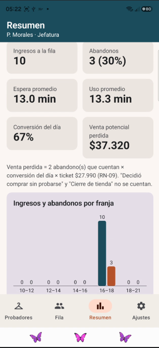 |

Conectada a los microservicios (Samsung Galaxy A14, APK firmado 1.0.0): la cuenta del cliente y su turno quedan en MySQL, y el llamado llega en vivo desde el servidor.

| Cliente conectado | Turno tomado | Turno llamado |
|---|---|---|
| 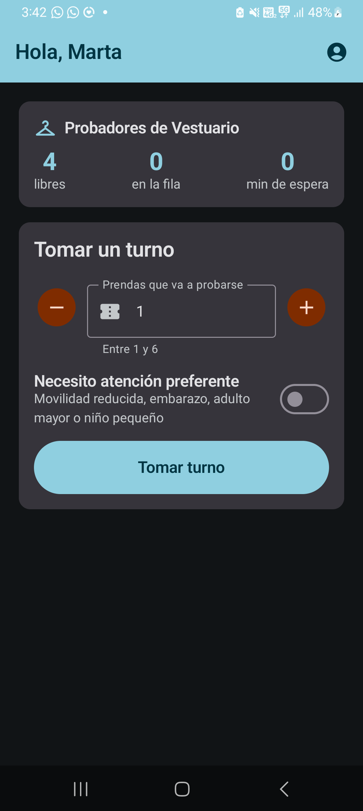 | 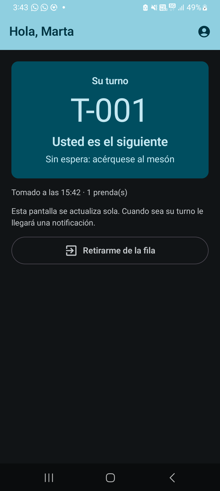 | 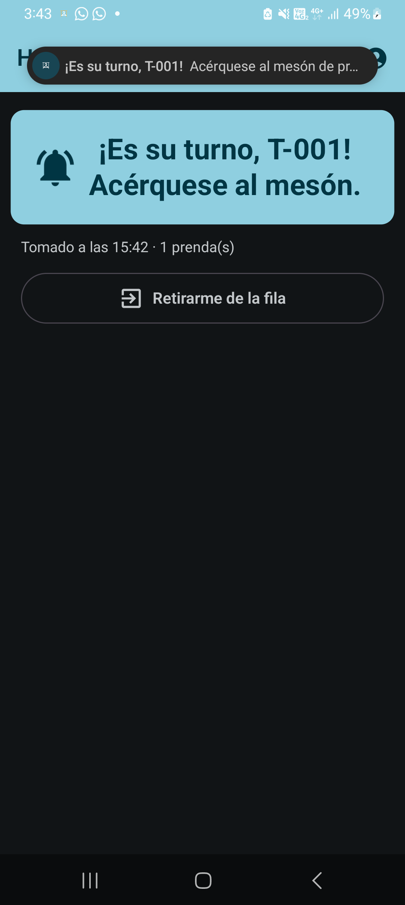 |

| API externa: clima de la tienda (Open-Meteo) |
|---|
| 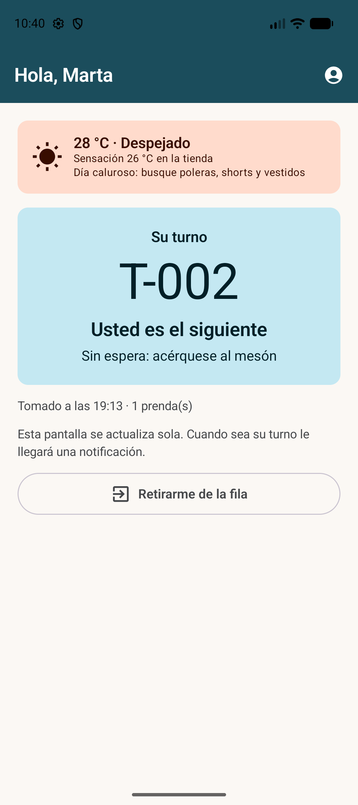 |

## Estructura

```
model/        entidades y reglas de negocio
data/         repositorio y preferencias
data/local/   base de datos Room: entidades, relaciones y DAOs
data/remote/  Retrofit: APIs, DTOs, conversión y sincronización con los microservicios
data/cuentas/ ingreso y contraseñas (servidor o teléfono)
viewmodel/    estado y validaciones de cada pantalla
navigation/   rutas y navegación
permisos/     verificación de permisos y acceso a Ajustes del sistema
ui/           tema, componentes y pantallas
utils/        validaciones, RUT, contraseñas, fechas, imágenes, vibración y notificaciones
docs/         capturas de funcionamiento
```

## Endpoints utilizados

### API externa: Open-Meteo (clima)

Pública, gratuita y sin clave. Se consume con su propio Retrofit (`data/externa/ClimaApi.kt`) y se muestra en
la tarjeta de clima (`ui/components/ClimaCard.kt`).

| Método | Endpoint | Uso en la app |
|---|---|---|
| GET | `https://api.open-meteo.com/v1/forecast?latitude=-33.36&longitude=-70.73&current=temperature_2m,apparent_temperature,weather_code&timezone=America/Santiago` | Temperatura, sensación térmica y estado del tiempo en la tienda |

### Microservicios propios (a través del API Gateway, puerto 8080)

Definidos en `data/remote/ApiServicios.kt`. La dirección base se configura con el botón **Servidor**.

| Servicio | Método | Endpoint | Uso en la app |
|---|---|---|---|
| usuarios-service | GET | `/api/usuarios` | Descargar colaboradores y clientes |
| usuarios-service | GET | `/api/usuarios/{rut}` | Buscar una cuenta al ingresar |
| usuarios-service | GET | `/api/usuarios/estado-inicial` | Saber si la sección ya está configurada |
| usuarios-service | POST | `/api/usuarios/configuracion-inicial` | Crear la cuenta de jefatura (asistente inicial) |
| usuarios-service | POST | `/api/usuarios/registro` | Crear cuenta de cliente |
| usuarios-service | POST | `/api/usuarios/colaboradores` | Agregar colaborador (jefatura) |
| usuarios-service | PUT | `/api/usuarios/{rut}` | Editar datos del colaborador o del cliente |
| usuarios-service | POST | `/api/usuarios/login` | Ingresar con RUT y contraseña |
| usuarios-service | POST | `/api/usuarios/{rut}/contrasena` | Crear contraseña (primer ingreso) |
| usuarios-service | PUT | `/api/usuarios/{rut}/contrasena` | Cambiar contraseña |
| usuarios-service | POST | `/api/usuarios/{rut}/recuperar` | Recuperar contraseña con el código |
| usuarios-service | DELETE | `/api/usuarios/{rut}/contrasena` | Restablecer contraseña (jefatura) |
| probadores-service | GET | `/api/probadores` | Estado de los probadores |
| probadores-service | PUT | `/api/probadores/{codigo}` | Crear o actualizar un probador (asignar, terminar, fuera de servicio…) |
| probadores-service | DELETE | `/api/probadores/{codigo}` | Eliminar un probador sin uso |
| probadores-service | GET | `/api/probadores/usos` | Usos de los probadores |
| probadores-service | PUT | `/api/probadores/usos/{id}` | Registrar el inicio o término de un uso |
| probadores-service | GET | `/api/probadores/cambios` | Historial de cambios de estado |
| probadores-service | POST | `/api/probadores/cambios` | Registrar un cambio de estado |
| turnos-service | GET | `/api/turnos` | Fila del día |
| turnos-service | PUT | `/api/turnos/{id}` | Crear o actualizar un turno (llamar, atender, abandono) |
| turnos-service | GET | `/api/turnos/parametros` | Parámetros de la sección |
| turnos-service | PUT | `/api/turnos/parametros` | Guardar parámetros (jefatura) |

Con esto la app cubre el CRUD completo: crea (turnos, cuentas, probadores, colaboradores), lee (sincronización
cada 5 segundos), actualiza (estados, datos y parámetros) y elimina (probadores y contraseñas).

## APK firmado y llave (.jks)

| Archivo | Qué es |
|---|---|
| [`distribucion/ProbadoresRS-1.1.0.apk`](distribucion/ProbadoresRS-1.1.0.apk) | APK de la versión `release`, firmado (APK Signature Scheme v2) |
| [`keystore/probadores-rs.jks`](keystore/probadores-rs.jks) | Llave generada con `keytool` (RSA 2048, alias `probadores-rs`, 10 000 días) |
| [`keystore.properties.example`](keystore.properties.example) | Plantilla de la configuración de firma |
| [`app/build.gradle.kts`](app/build.gradle.kts) | `signingConfigs` → `distribucion`, usado por el `buildType` `release` |

Las contraseñas de la llave no están en el repositorio: se entregan aparte (AVA).

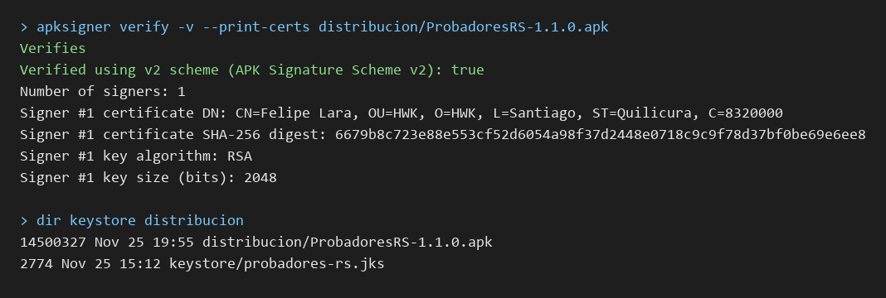

### Cómo se generó

1. Llave: `keytool -genkeypair -v -keystore keystore/probadores-rs.jks -alias probadores-rs -keyalg RSA -keysize 2048 -validity 10000`
2. Configuración: copiar `keystore.properties.example` como `keystore.properties` y escribir las contraseñas
   (`keystore.properties` está en `.gitignore`).
3. Compilación firmada: `./gradlew assembleRelease bundleRelease`
   - APK: `app/build/outputs/apk/release/app-release.apk`
   - AAB: `app/build/outputs/bundle/release/app-release.aab`
4. Verificación: `apksigner verify -v --print-certs distribucion/ProbadoresRS-1.1.0.apk`

La app se instala como **Probadores RS** (versión 1.1.0), con ícono propio y Splash Screen.

## Pruebas

```
./gradlew testDebugUnitTest      # ejecutar las pruebas
./gradlew coberturaLogica        # reporte JaCoCo: app/build/reports/jacoco/coberturaLogica/html/index.html
./gradlew verificarCobertura     # falla si la cobertura de la lógica baja de 80 %
```

81 pruebas unitarias (JUnit 4 y kotlinx-coroutines-test) en 4 archivos (`app/src/test`), todas en verde.
No hay pruebas de interfaz ni instrumentadas.

**Cobertura de la lógica (JaCoCo): 96 % de las líneas.** La lógica incluye las reglas de negocio (`model`),
las utilidades, los repositorios remotos con Retrofit (microservicios y API externa), las cuentas remotas y
el `ClimaViewModel`. Las pruebas de repositorio y de ViewModel usan APIs falsas (FakeApi) en lugar del servidor real.

| Clase | Pruebas | Qué prueba |
|---|---|---|
| `ReglasNegocioTest` | 30 | Reglas de la fila y los probadores, transiciones inválidas, resumen, estimación de espera, alertas y formatos |
| `CuentasYRolesTest` | 19 | Cuentas de cliente, turno propio, permisos de cada rol, hash de contraseñas, código de recuperación y bloqueo por intentos |
| `ConfiguracionSeccionTest` | 10 | Configuración inicial, mantenedor de probadores y validaciones de formulario |
| `IntegracionServidorTest` | 22 | Repositorios remotos: sincronización, cuentas y errores contra los microservicios simulados; API externa de clima (`ClimaRepository` y `ClimaViewModel`) |

## Microservicios

El backend del caso (Spring Boot, API REST y pruebas unitarias) está en un repositorio aparte:
`ms-ProbadoresRinconSur`, con `usuarios-service`, `probadores-service`, `turnos-service`, Eureka y API Gateway.
