# Probadores Rincón Sur

Aplicación móvil para la sección Vestuario de Tienda Rincón Sur (sucursal RS-014 Zona Norte).
Permite llevar la fila de espera y el estado de los probadores, informar al cliente el tiempo
estimado de espera y entregar a la jefatura un resumen diario con la venta potencial perdida.

Evaluación Parcial 2 · DSY1105 Desarrollo de Aplicaciones Móviles · Sección 003D · Equipo EQ020

## Integrantes

- Felipe Antonio Lara Ruiz
- Sebastián Ariel Villagra Luengo

## Funcionalidades implementadas

**Cliente (sin registro ni datos personales)**
- Pantalla de espera con probadores libres, personas en la fila y tiempo estimado de espera.
- Consulta del propio turno por número: personas antes, espera estimada y aviso cuando es llamado.

**Asistente de probadores y vendedor(a)**
- Ingreso con RUT validado (dígito verificador, colaborador registrado y activo).
- Estado en tiempo real de los 8 probadores (libre, ocupado, en ordenamiento, fuera de servicio).
- Registro de turnos en la fila (1 a 6 prendas, atención preferente con motivo).
- Llamado de turnos, asignación de probador sugerido, registro de no presentación y abandono con motivo.
- Uso de probador sin fila, incluso registrado con atraso de hasta 15 minutos.
- Término de uso con prendas devueltas y ordenamiento del probador.
- Alertas de uso prolongado, probador libre sin asignar, turno sin presentarse y cierre de la fila, con vibración.

**Jefatura**
- Todo lo anterior.
- Marcar probadores fuera de servicio con motivo y foto de evidencia (cámara o galería), y volver a habilitarlos.
- Resumen por día y franja horaria: ingresos, abandonos, espera y uso promedio, conversión y venta potencial perdida.
- Mantenedor de colaboradores y ajuste de parámetros de la sección.
- Cierre de jornada.

## Tecnologías

- Kotlin, Jetpack Compose y Material 3
- Arquitectura MVVM con StateFlow
- Navigation Compose
- DataStore Preferences
- Cámara y galería con ActivityResultLauncher y FileProvider
- Vibración del dispositivo

## Ejecución

1. Clonar el repositorio y abrir la carpeta del proyecto en Android Studio.
2. Sincronizar Gradle y ejecutar el módulo `app` en un emulador o teléfono (Android 8.0 o superior).
3. Ingresar con un RUT de prueba:

| RUT | Perfil |
|---|---|
| 12.984.561-9 | Jefatura |
| 16.842.311-K | Asistente de probadores |
| 17.550.982-8 | Vendedor(a) |
| 18.447.093-4 | Inactivo |

Fuera del horario de la tienda (10:00 a 21:00) se puede activar el modo demostración en Ajustes.

## Capturas

Tomadas en un dispositivo físico.

| Probadores | Asignar probador | Fila de espera |
|---|---|---|
| 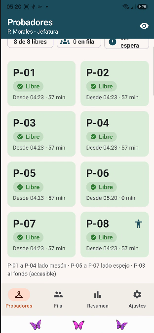 | 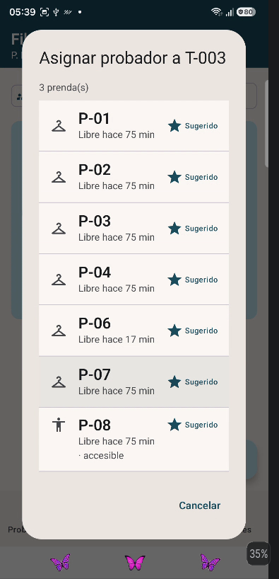 | 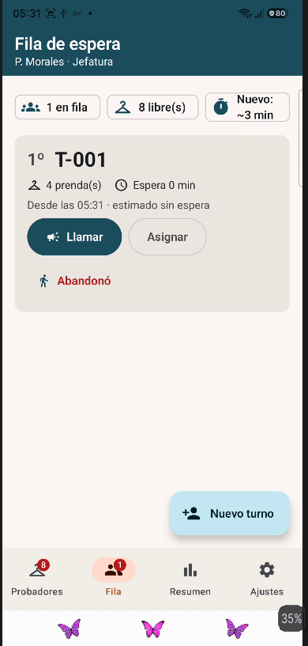 |

| Nuevo turno | Turno registrado | Consulta del cliente |
|---|---|---|
| 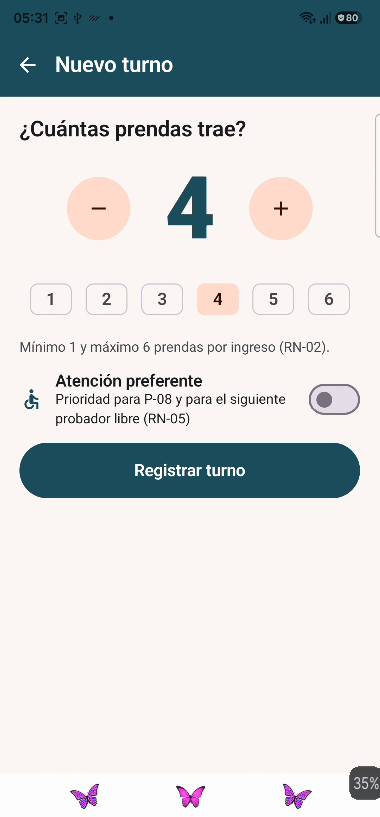 | 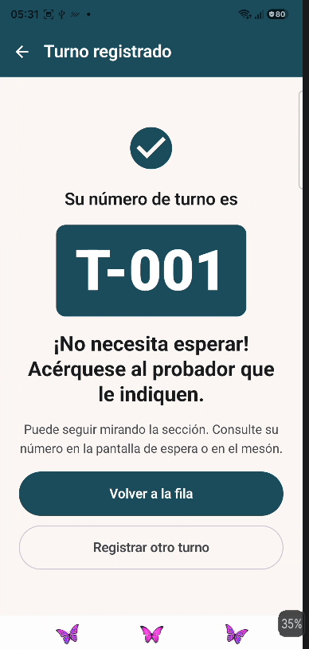 | 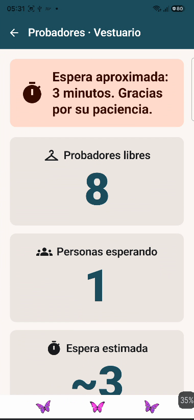 |

| Uso sin fila | Abandono | Nuevo colaborador |
|---|---|---|
| 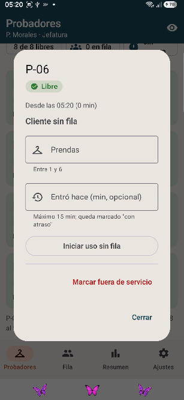 | 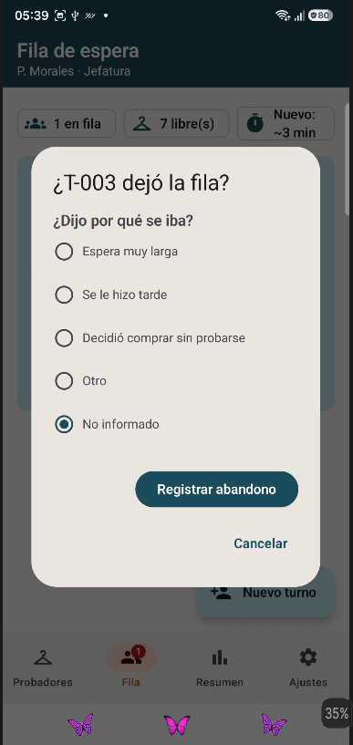 | 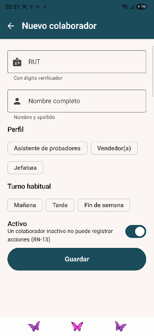 |

| Fuera de servicio | Cámara | Probador con evidencia | Resumen |
|---|---|---|---|
| 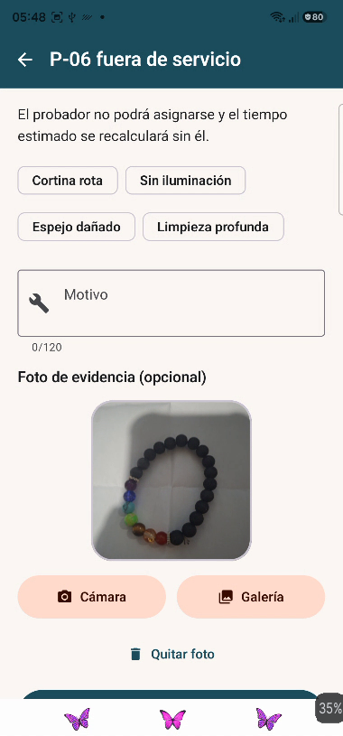 | 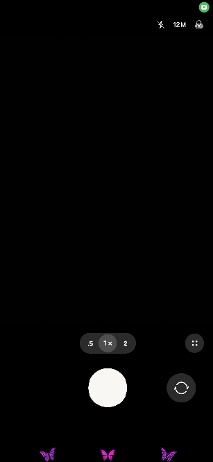 | 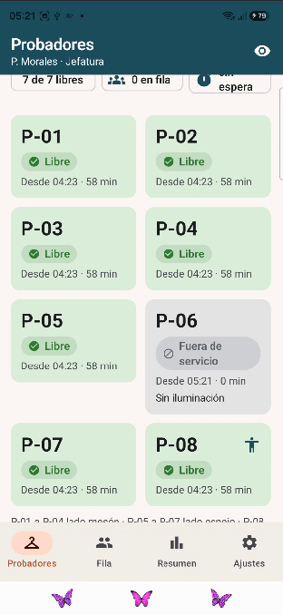 | 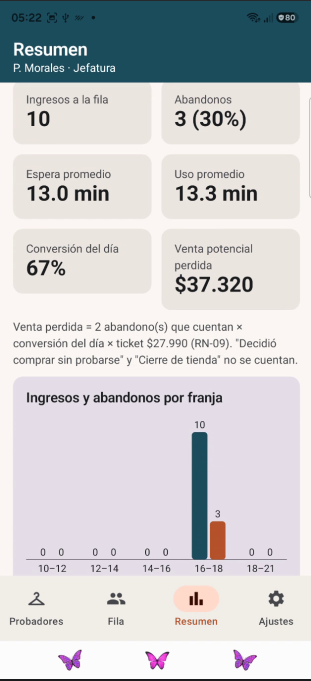 |

## Estructura

```
model/        entidades y reglas de negocio
data/         almacenamiento local y datos de ejemplo
viewmodel/    estado y validaciones de cada pantalla
navigation/   rutas y navegación
permisos/     solicitud del permiso de cámara
ui/           tema, componentes y pantallas
utils/        validación de RUT, fechas, imágenes y vibración
docs/         capturas de funcionamiento
```

## Pruebas

```
./gradlew testDebugUnitTest
```
