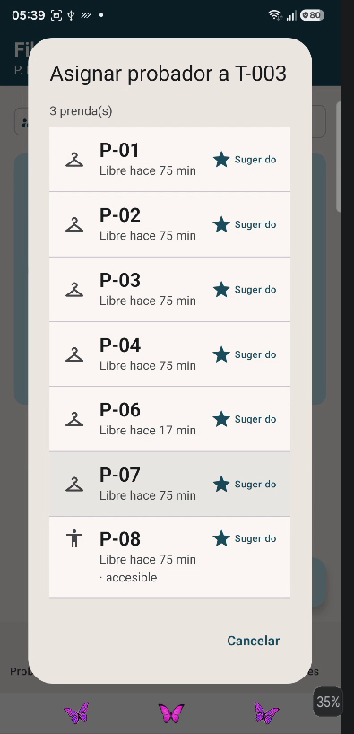
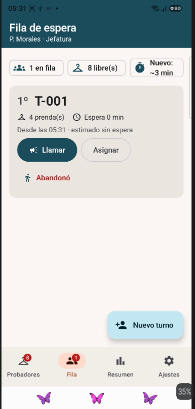
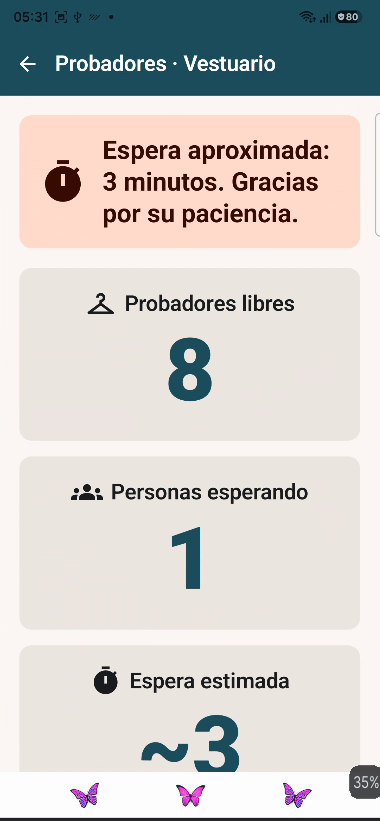
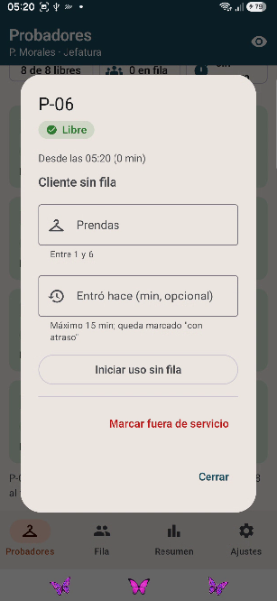
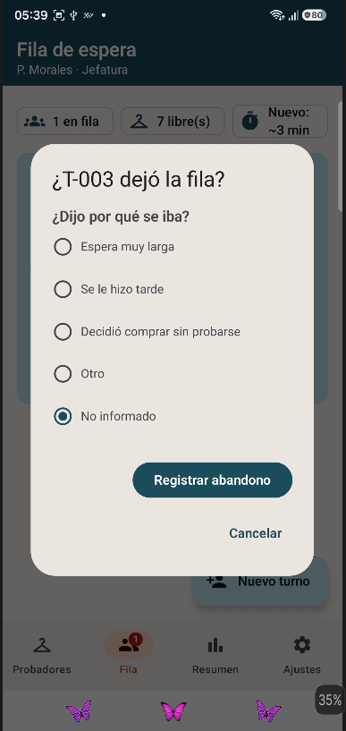
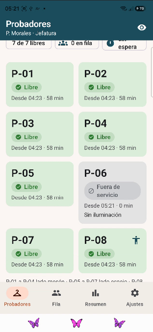

# Probadores Rincón Sur

Aplicación móvil para la sección Vestuario de Tienda Rincón Sur (sucursal RS-014 Zona Norte).
Permite llevar la fila de espera y el estado de los probadores, informar al cliente el tiempo
estimado de espera y entregar a la jefatura un resumen diario con la venta potencial perdida.

Evaluación Parcial 2 · DSY1105 Desarrollo de Aplicaciones Móviles · Sección 003D · Equipo EQ020

## Integrantes

- Felipe Antonio Lara Ruiz
- Sebastián Ariel Villagra Luengo

## Funcionalidades implementadas

Todas las cuentas ingresan con **RUT y contraseña**. Nada se ve sin cuenta, y cada tipo de cuenta abre en su propia vista.

**Cliente (crea su propia cuenta con RUT, nombre y contraseña)**
- Toma un turno desde su teléfono indicando las prendas y si necesita atención preferente.
- Sigue su turno en vivo: personas antes, espera estimada y aviso cuando lo llaman.
- Puede retirarse de la fila indicando el motivo.

**Vendedor(a) (abre en Fila)**
- Registra turnos en el mesón (1 a 6 prendas, atención preferente con motivo) y los retiros de la fila.
- Consulta el estado de los probadores, sin operarlos.

**Asistente de probadores (abre en Probadores)**
- Estado en tiempo real de los probadores de la sección (libre, ocupado, en ordenamiento, fuera de servicio).
- Llamado de turnos, asignación de probador sugerido y registro de no presentación.
- Uso de probador sin fila, incluso registrado con atraso de hasta 15 minutos.
- Término de uso con prendas devueltas y ordenamiento del probador.
- Alertas de uso prolongado, probador libre sin asignar, turno sin presentarse y cierre de la fila, con vibración.

**Jefatura (abre en Resumen)**
- Todo lo del asistente y del vendedor(a).
- Marcar probadores fuera de servicio con motivo y foto de evidencia (cámara o galería), y volver a habilitarlos.
- Resumen por día y franja horaria: ingresos, abandonos, espera y uso promedio, conversión y venta potencial perdida.
- Crea las cuentas de los colaboradores (solo la jefatura puede hacerlo) y restablece sus contraseñas.
- Mantenedor de probadores (agregar, cambiar el tipo, eliminar) y ajuste de parámetros de la sección.
- Configuración inicial de la sección la primera vez que se abre la app.
- Cierre de jornada.

**Todas las cuentas**
- Mi perfil: ver y editar los datos propios (nombre y, en colaboradores, turno habitual).
- Cambiar contraseña indicando la actual; recuperar la contraseña con el código de recuperación.
- Modo punto de espera (colaboradores): deja el equipo mostrando la espera a los clientes; salir pide la contraseña.

## Tecnologías

- Kotlin, Jetpack Compose y Material 3
- Arquitectura MVVM con StateFlow
- Navigation Compose
- Room (entidades, DAOs y relaciones) para los datos del negocio, con un repositorio entre los ViewModels y la base de datos
- DataStore Preferences solo para la sesión y las preferencias del equipo
- Cámara y galería con ActivityResultLauncher y FileProvider
- Vibración del dispositivo

## Ejecución

1. Clonar el repositorio y abrir la carpeta del proyecto en Android Studio.
2. Sincronizar Gradle y ejecutar el módulo `app` en un emulador o teléfono (Android 8.0 o superior).
3. La app parte **sin datos**. La primera vez abre el asistente de configuración inicial:
   1. Crear la cuenta de jefatura (RUT, nombre, turno y contraseña).
   2. Indicar cuántos probadores estándar y accesibles tiene la sección.
   3. Anotar el código de recuperación que se muestra una sola vez.
4. Desde Ajustes, la jefatura agrega al resto del equipo (Colaboradores) y administra los probadores.

Al abrir la app se muestra directamente el ingreso. Si ya hay una sesión abierta, la app entra directo a la vista de esa cuenta.

Fuera del horario de la tienda (10:00 a 21:00) se puede activar el modo demostración en Ajustes.

### Cuentas y contraseñas

- **Cliente:** crea su cuenta desde el ingreso ("Crear cuenta de cliente") con RUT, nombre y contraseña.
- **Colaborador:** su cuenta solo la crea la jefatura en Ajustes → Colaboradores. En su primer ingreso elige su contraseña.
- Un mismo RUT no puede tener cuenta de cliente y de colaborador.
- Al crear o cambiar la contraseña se muestra una sola vez un **código de recuperación** (`XXXX-XXXX`).
  Con "¿Olvidó su contraseña?" se ingresa ese código y se elige una nueva. A un colaborador sin código,
  la jefatura le puede restablecer la contraseña.
- 5 intentos fallidos bloquean el ingreso por 1 minuto. Las contraseñas y códigos se guardan como hash PBKDF2 con sal.
- La pantalla recuerda los últimos accesos del equipo para ingresar con un toque.

## Capturas

Tomadas en un dispositivo físico.

| Probadores | Asignar probador | Fila de espera |
|---|---|---|
|  |  |  |

| Nuevo turno | Turno registrado | Consulta del cliente |
|---|---|---|
|  |  |  |

| Uso sin fila | Abandono | Nuevo colaborador |
|---|---|---|
|  |  |  |

| Fuera de servicio | Cámara | Probador con evidencia | Resumen |
|---|---|---|---|
|  |  |  |  |

## Estructura

```
model/        entidades y reglas de negocio
data/         repositorio y preferencias
data/local/   base de datos Room: entidades, relaciones y DAOs
viewmodel/    estado y validaciones de cada pantalla
navigation/   rutas y navegación
permisos/     solicitud del permiso de cámara
ui/           tema, componentes y pantallas
utils/        validación de RUT, fechas, imágenes y vibración
docs/         capturas de funcionamiento
```

## Pruebas

```
./gradlew testDebugUnitTest
```
